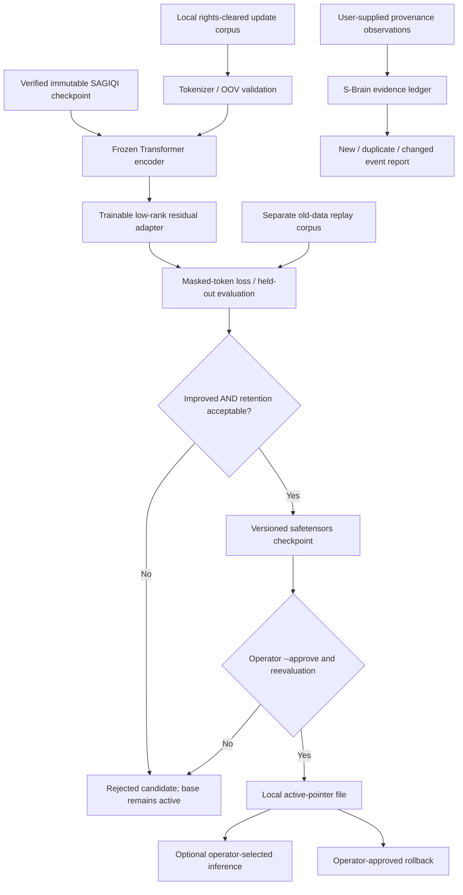

# GPT-Delta: bounded, trainable SAGIQI model updates

**Status:** functional research prototype. GPT-Delta is an actual PyTorch neural
adapter to `gpt-almighty-sonoxo-mlm-sagiqi`. It is **not** a new pretrained
foundation model, general intelligence, a living chip or an autonomous coding agent.

## Architecture



## Actual neural architecture

- Frozen parent: the existing PyTorch bidirectional Transformer masked-language model. The parent's checkpoint is verified by its SHA-256 manifest every time it is loaded.
- Delta: two trainable linear weights (`down: d_model → rank`, `up: rank → vocab_size`), with `alpha/rank` scaling. The initially zero `up` projection makes the first adapter output exactly equal to the parent.
- Prediction: `parent_logits + (alpha/rank) * up(down(hidden_state))`. The adapter can learn from gradients; all parent weights remain frozen.
- In the included demonstration with `d_model=64`, `rank=4`, `vocab_size=256`: **1,280 trainable adapter parameters** versus **103,168 parameters** in the parent.
- Frozen word-level tokenizer: no new vocabulary is learned. Unknown word ratio is measured and gates promotion.
- Model files use `safetensors` and SHA-256 checksums. Adapters are tied to one exact parent hash and are never loaded as executable Python pickles.

## Measured evaluation and safeguards

The local `train` command divides the *new* corpus into adaptation and held-out slices. The old-data replay corpus is evaluated separately. It computes the same masked-token examples before and after the update, plus in-vocabulary coverage.

Promotion requires **all** of these:

1. Held-out loss is improved by at least the configured minimum gain.
2. A distinct replay corpus is supplied; its loss regression is no greater than the configured threshold.
3. The unseen-token rate remains below its cap.
4. The operator explicitly invokes `promote --approve` with the original update and replay corpora. GPT-Delta rereads the corpora, verifies their hashes, recomputes actual losses using the saved weights, verifies the model hashes and gating outcomes, and changes **only a local version-pointer file**.

Rollback is an explicit, separately approved local operation. Neither command deploys code, edits source files, updates remote systems, or autonomously routes new traffic. The actual `ai_killswitch` must be clear for training, inference, evidence updates and promotion.

**Important:** evaluation on a small corpus is *not* independent proof of generalization. The SHA-256 hash proves content consistency, not authenticity or external source reliability. The operator must review data rights, model use policy, drift and downstream tests before production.

## Ontology/evidence delta

The `observe` command uses the shared `gpt_brain.s_brain.SBrain` store when it is installed. Because S-Brain is currently on a feature lineage and may not be on `main`, GPT-Delta also provides a **standalone SQLite fallback**, with the same source-tagged, append-only status events and secret-like input rejection. Caller-supplied observations are deduplicated by `(subject,predicate,value,source,URI)`. A conflicting or changed value yields a `changed` event and identifies existing source IDs. The fallback can later be reconciled with the canonical S-Brain ontology under an explicit migration. Such records are **not independently verified** by ingesting them.

## Install and run

From this repository root:

```sh
python3 -m pip install -e '.[mlm]'
gpt-delta train --base /path/to/base-model \
  --corpus data/gpt_delta_research_seed.txt \
  --replay data/almighty_sonoxo_seed.txt \
  --output ~/.gpt-doug/models/gpt-delta/candidate-1 \
  --epochs 1 --rank 4 --learning-rate 0.001

gpt-delta inspect --base /path/to/base-model \
  --candidate ~/.gpt-doug/models/gpt-delta/candidate-1

gpt-delta predict --base /path/to/base-model \
  --candidate ~/.gpt-doug/models/gpt-delta/candidate-1 \
  --text 'the ontology stores [MASK] with provenance' --top-k 5
```

**Promotion (not automatic):**

```sh
gpt-delta promote --base /path/to/base-model \
  --candidate ~/.gpt-doug/models/gpt-delta/candidate-1 \
  --corpus data/gpt_delta_research_seed.txt \
  --replay data/almighty_sonoxo_seed.txt \
  --registry ~/.gpt-doug/models/gpt-delta/active.json --approve

gpt-delta rollback --registry ~/.gpt-doug/models/gpt-delta/active.json --approve
```

**Source-aware ontology event:**

```sh
gpt-delta observe --database ~/.gpt-doug/s-brain/evidence.sqlite3 \
  --subject NCT00000000 --predicate recruitment --value recruiting \
  --source-id registry-snapshot-20261014 \
  --source-uri https://clinicaltrials.gov/study/NCT00000000
```

The NCT number above is just an input-format placeholder, not an asserted live trial or actual recruitment event.

## Reproduction and validation

```sh
python -m unittest tests.test_delta -v
```

The CI workflow runs real training and inference tests on Python 3.11 and 3.12 with a local generated parent checkpoint; it never needs a provider key, network model download or hardware device. The saved sample adapter and trained base model are available as a separate downloadable evaluation bundle, not committed as production weights.

## Bounded next steps

1. Add an independently held-out, time-separated evaluation dataset and calibrated metric uncertainty.
2. Incorporate rehearsal batches and regularization to reduce retention regression.
3. Build authorized benchmark suites for clinical trials, cybersecurity, and document retrieval without silently treating model-generated assertions as facts.
4. Promote to a deployment environment only after its independent acceptance checks and responsible owner review.
